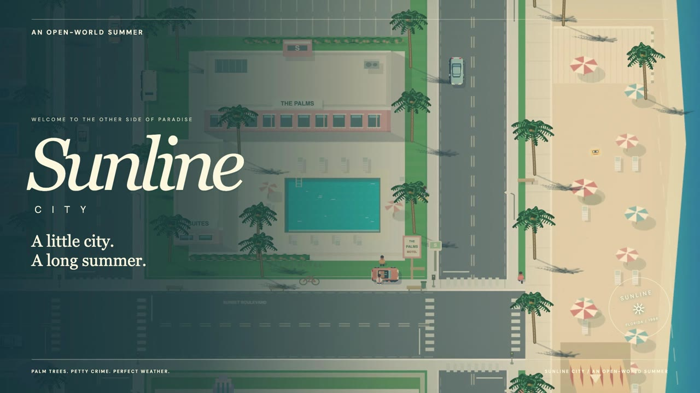

# SUNLINE CITY

A little city. A long summer.

An original 2D coastal open-world game with tiny characters, hand-drawn architecture, driving, story jobs, and repeatable adventures. The painted coast keeps its cobalt ocean, cream buildings, turquoise pools, coral details, palms, and long afternoon shadows.

[Play in your browser](https://sunline-city-summer.fal-ai-3289.chatgpt.site/) · [Watch the gameplay demo](demo/sunline-city-action-demo.mp4)

## Gameplay demo

[](demo/sunline-city-action-demo.mp4)

A 30-second gameplay trailer with original game music and sound effects. [Open or download the 1080p MP4](demo/sunline-city-action-demo.mp4).

## Play locally

Node.js 20.19+ or 22.12+ is required.

```sh
npm ci
npm run dev
```

Open http://127.0.0.1:5174. `npm run build` creates the production build; `npm run preview` serves it.

## The county

The 5200 × 5700 world has ten neighborhoods: Ocean Beach, Little Havana, Mirage District, Palm Grove, Palomar Hills, Downtown Sunline, Port Azul, Cypress Park, Solstice Fairgrounds, and Sunline Speedway. Market awnings, pastel nightlife, beach courts, hillside villas, towers, cranes, woodland boardwalks, fairground tents, and trackside buildings give each area its own character. Traffic connects the coast and southern county. The map has whole-county, north-coast and south-county views, with filters for adventures, services, stunts, and exploration.

Press **J** for the adventures guide, choose a starting point, drive there, and press **E** at its lettered marker. There are nine repeatable activities:

- **Coastline Club, County Run, Sunset Speedway:** three checkpoint races with countdowns, personal records and bronze/silver/gold medals. Medal improvements award bonuses once; replayed races still pay their base reward.
- **Golden Cab Shift:** a three-passenger shift with timed fares and tips reduced by vehicle damage.
- **Special Order:** steal the requested silver sports car, lose the patrols, and deliver it for a condition-based payment.
- **Dockyard Defense:** three waves of armed enemies, with short breaks, partial recovery and ammunition between waves.
- **The Coral Exchange:** collect a marked van, clear the guarded exchange, take the case on foot, escape the police, and deliver it to the hideaway.
- **Dead Calm:** find and subdue a fugitive and crew, secure the target, and return to county dispatch.
- **Six in the Sun:** a safe, timed shooting gallery with six targets and performance medals.

Six stunt ramps reward a first clean landing with $300. Approach straight at speed and keep driving through the landing. Twelve original hidden mixtapes still pay $100 each. The original five-job story remains available through its gold contact markers. Finish a current story job before starting a side adventure; only one side adventure runs at a time. The guide can abandon an activity without losing earlier rewards.

## Explore at your own pace

Press **P** to open the neighborhood journal. It records all ten discoveries, nine photo postcards, and your best drift, and lets you mark places on the map. Spending a moment in a neighborhood awards its first-visit bonus of $40 once.

Find a camera marker, step out of your car, and press **C** to take a postcard. Each view pays $150; collecting all nine adds a one-time $500 album bonus. The journal keeps an actual image of the scene you photographed. Photos require no police heat.

Four food stands sell local snacks and drinks for $25–$45 and restore 30–55 health. Press **E** near a stand while on foot and out of trouble. Full health, insufficient funds, or a short meal cooldown prevents a purchase. When a car and food stand are both close, E chooses the nearer target; ties favor the car.

Ten shuttle stops connect neighborhoods you have already discovered. Walk to a bus stop, press **G**, then choose a destination in the journal for $60. Travel is available between story jobs and adventures, with no police heat. The journal also offers three lighting moods: **Endless afternoon**, **Golden hour**, and **Blue hour**. Lighting is a saved display choice and does not alter gameplay.

## Driving

Cars have distinct top speeds, stronger acceleration, and different grip on pavement, dirt, grass, and sand. Hold **Shift** in a car for rechargeable nitro: a full tank lasts about four seconds and raises top speed while active. Release it to recover charge; after emptying the tank, release Shift before boosting again. Full recharge takes about seven seconds after a short delay. The HUD shows remaining charge.

At speed, steer while holding **Space** to drift. A moving drift chain builds points and a multiplier; straighten out cleanly to bank it. Collisions discard an unbanked chain. Best drift and total records persist, with small cash rewards limited by a payout cooldown. Space also works as a straight-line handbrake, and Shift remains sprint on foot.

## Combat and progression

The Service Pistol is available immediately. Sunline Sporting Arms sells a rapid-firing Coastline SMG, a short-range Boardwalk Pump shotgun, and a precise Ranger Carbine. Each has its own magazine, reserve, recoil/spread, reload time, range, and sound. Hold the mouse button or Space to fire; bullets hit enemies, vehicles and walls. Enemies telegraph their shots so you can sidestep, dodge, or move behind cover. Target practice is safe; gunfire in the city attracts patrols.

Open the loadout with **B** and select owned weapons with **1–4**. Visit the weapon shop in Downtown and press **G** for purchases and ammunition. Resting at The Palms or Palomar Hideaway restores health and starter-pistol ammunition.

At Sol Auto or Palomar Hideaway, stop a car and press **G** for two engine stages, a handling kit, repairs, and six paint colors. Tuning and paint persist for that vehicle model. **R** remains a quick repair at the original Sol Auto.

## Controls

| Action | Keyboard / mouse |
| --- | --- |
| Walk / drive | WASD or arrows |
| Sprint on foot / nitro in a car | Hold Shift |
| Interact / enter / exit / handoff | E |
| Aim | Mouse |
| Fire on foot | Hold left click or Space |
| Reload / quick repair at Sol Auto | R |
| Dodge on foot | Q |
| Select weapon | 1–4 |
| Loadout | B |
| Adventures guide | J |
| Neighborhood journal / lighting | P |
| Take postcard near a camera marker | C |
| Shop / workshop / shuttle stop when nearby | G |
| Handbrake / drift while steering | Space |
| Horn | H |
| Map / destination | M |
| Pause | Escape |
| Radio / sound | V |
| Fullscreen | F |

Phones and tablets show movement, action, fire/brake, sprint/boost, reload, weapon-cycle and dodge buttons. The sprint button becomes **BOOST** in a car. A camera/**C** button appears near a camera marker on foot; the journal button is in the top toolbar. Touch fire assists toward the closest visible combat target. A **G** touch button appears near shops, workshops and shuttle stops; **E** handles interactions and vehicles. Both portrait and landscape layouts are supported.

## Saves and recovery

Progress saves in this browser after rewards, purchases, reloads, escapes and repairs, and when leaving. Existing version-one saves are supported. Story progress, cash, mixtapes, weapon ownership/ammunition, activity records, car upgrades, jump completions, neighborhood discoveries, postcard images, meals and shuttle trips, nitro charge, drift records, and position persist. Active jobs/adventures restart at their contacts after reloading. Vehicle ownership and police heat remain session-only.

Taking another car, firing in the city, and hard traffic collisions attract police. Break line of sight for fourteen seconds to escape. Getting arrested or wiped out returns you to The Palms and charges up to $150. New Summer asks before resetting progress.

## Implementation

Vite, native Canvas 2D and Web Audio; no game engine or downloaded game art. Scenery uses lazy 768px tiles with a bounded cache and padded edges, painter-sorted sprites, and viewport culling.

- `src/world.js`, `src/world-expansion.js`, `src/neighborhood-art.js`: city/county art, neighborhood architecture, terrain, road topology, landmarks and collision geometry.
- `src/simulation.js`: movement, traffic, police, original story and system integration.
- `src/combat.js`, `src/combat-render.js`: weapons, ammunition, encounters, enemy AI, damage and feedback.
- `src/activities.js`, `src/activity-render.js`: repeatable adventures, records, objective logic and actors.
- `src/county.js`: stunt progression, model-specific tuning, paint and services.
- `src/driving.js`, `src/driving-render.js`: arcade handling, nitro, terrain grip, drift scoring and driving effects.
- `src/exploration.js`, `src/exploration-render.js`, `src/journal.js`: discoveries, photo postcards, food stands, shuttle travel and the journal.
- `src/atmosphere.js`, `src/neighborhood-ui.css`: lighting moods, ambient detail and neighborhood interface styles.
- `src/maps.js`, `src/panels.js`, `src/main.js`: atlas, interface, input, rendering and persistence.
- `src/sprites.js`, `src/audio.js`: tiny characters/vehicles and original synthesized music/effects.

`window.render_game_to_text()` exposes concise gameplay state; `window.advanceTime(ms)` supports deterministic input tests. Development builds also expose `window.__SUNLINE__`; production removes it.

## Validation

The browser checks require Google Chrome and Playwright Chromium (`npx playwright install chromium`). With the dev server running, `npm test` runs the original campaign regression tests plus combat, activities, county topology/traffic, expanded UI, upgrades, stunts, save migration, and mobile checks. The neighborhood checks additionally cover nitro and drift behavior, exploration rewards, postcard persistence, transit restrictions, lighting, mobile layout, and food-versus-car interaction priority. Browser scenarios use real DOM controls, with developer setup only for isolated starting states. Independent natural-input audits cover connected county driving, race routes and pistol-only survival. Tests fail on browser errors.

`tests/web_game_playwright_client.mjs` is an unchanged local copy of the develop-web-game skill client, allowing its imports to resolve the local Playwright dependency.

## Design research

The activities are original Sunline implementations inspired by Rockstar's official descriptions of [vehicle robberies](https://www.rockstargames.com/newswire/article/75k3149ko747ka/gta-online-the-chop-shop-now-available), [taxi work](https://www.rockstargames.com/newswire/article/17384a7312771k/take-on-a-new-side-hustle-with-the-taxi-at-the-downtown-cab-co/), [bounty hunting](https://support.rockstargames.com/articles/eUgRHVRSN2V9gimBT32YX/gtav-title-update-1-69-notes-ps5-ps4-xbox-series-x-s-xbox-one-pc), [stunt racing](https://www.rockstargames.com/newswire/article/398a4552514721/gta-online-cunning-stunts-coming-july-12th-watch-the-new), and [Freemode time trials](https://support.rockstargames.com/articles/6rd4EkjuDv0RgJiota4wqw/gtav-title-update-1-29-notes-ps4-xbox-one-pc).

## Checkpoint

Saved on October 15, 2026 from source snapshot `5955fe4e58e661c28e24739653f7969c0931f25a`. Includes the complete playable game, dependency lockfile, verification scripts, and approved gameplay demo. Deployment-specific configuration and generated development files are excluded.
